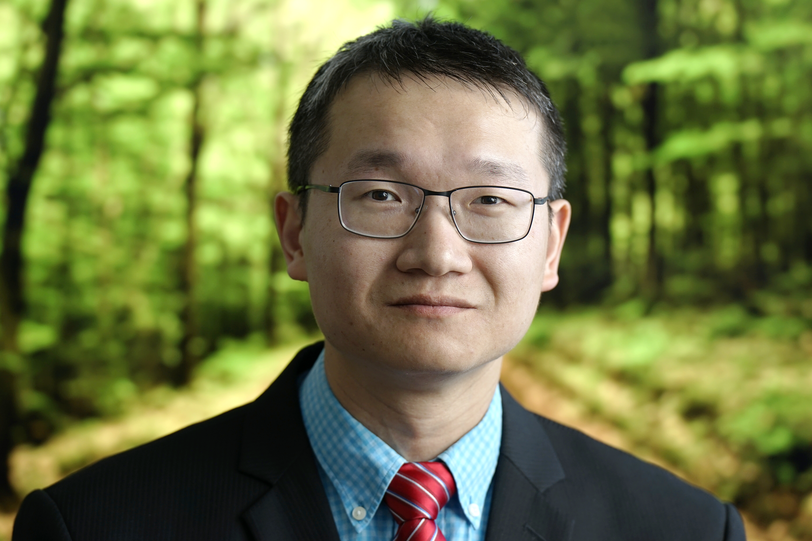

> 🚧 **Notice:** This page is currently being updated. Please check back soon.

{style="display: block; margin: 20px auto; width: 100%; max-width: 240px; border-radius: 12px;"}

# **Qingyang Liu (刘清扬)**
### Department of Statistical Sciences | Wake Forest University

---

## **Biography**

I am an Assistant Professor in the **Department of Statistical Sciences at Wake Forest University**, having joined the faculty in July 2026. 

My research focuses on developing robust statistical methods and deep learning models for complex, non-Gaussian data, with applications in causal inference and health science.

---

## **Experience & Education**

*   **Postdoctoral Research Associate** (May 2023 – June 2026)
    *   *Years 2 & 3:* University of Wisconsin–Madison
    *   *Year 1:* Texas A&M University
    *   *Supervisors:* [Dr. Debdeep Pati](https://pages.stat.wisc.edu/~dpati2/) & [Dr. Dipankar Bandyopadhyay](https://sites.google.com/view/dbandyop/)
*   **Ph.D. in Statistics** (Graduated May 2023)
    *   University of South Carolina
    *   *Advisor:* [Dr. Xianzheng Huang](https://people.stat.sc.edu/huang/)

---

## **Publications & Updates**

*   **[July 2026]** 🎉 Joined the Department of Statistical Sciences at Wake Forest University!
*   **[May 2023]** 🎓 Successfully defended my Ph.D. dissertation at the University of South Carolina.

---

> 📄 **[Download My CV (Updated Sept 2025)](./files/Qingyang_Liu_Curriculum_Vitae.pdf)**